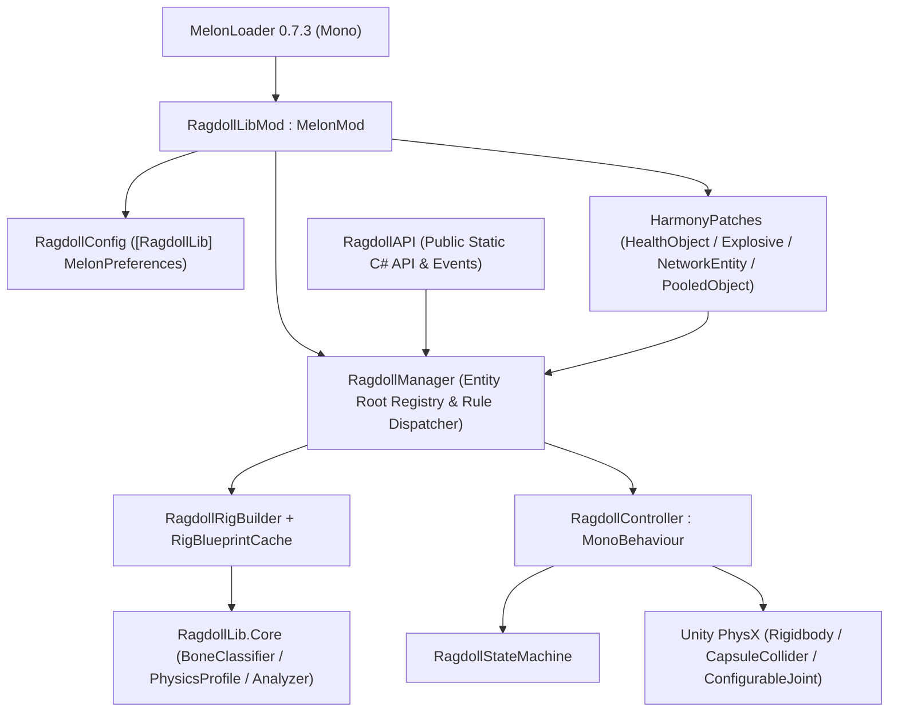
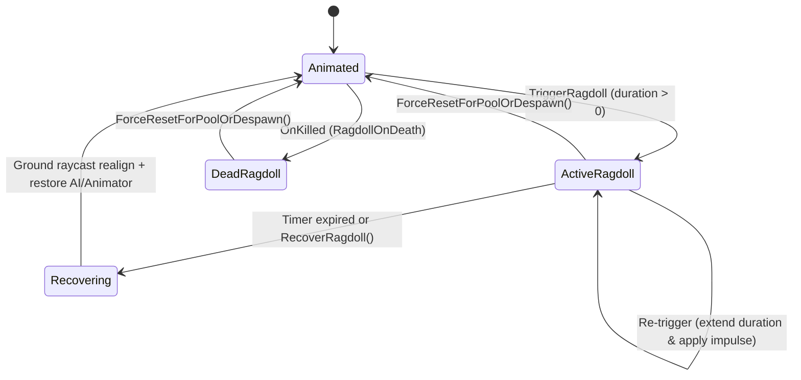

# RagdollLib — Architecture & Verified A Township Tale API Reference

All *A Township Tale* (ATT) runtime details, class names, namespaces, fields, properties, events, Harmony targets, and IL behaviors documented below were verified directly against the installed game binaries and runtime logs:
- `A Township Tale_Data/Managed/Root.Township.dll` (main game assembly; no `Assembly-CSharp.dll` exists)
- `MelonLoader/Latest.log` (`MelonLoader v0.7.3 Open-Beta`, `Runtime Type: net35`, `Unity 2020.3.23f1`, `Game Version: main-1.7.2.1.42203`)
- `MelonLoader/GameObjectDump.txt` (live scene hierarchy dump of creatures and `VR Player Character New(Clone)`)

Nothing in this document is guessed or invented.

---

## 1. Runtime, Mod Loader & Dependencies

| Component | Verified Value | Notes |
|---|---|---|
| Scripting Backend | **MonoBleedingEdge** (x64, `A Township Tale_Data/Managed/*.dll`, no `GameAssembly.dll`) | Custom `MonoBehaviour` subclasses run natively without IL2CPP registration |
| Mod Loader | **MelonLoader `v0.7.3 Open-Beta`** (`Runtime Type: net35`) | Uses `MelonLoader/net35/MelonLoader.dll` and `0Harmony.dll` |
| Unity Version | `2020.3.23f1` | `UnityEngine.CoreModule.dll`, `UnityEngine.PhysicsModule.dll`, `UnityEngine.AnimationModule.dll` |
| Game Identity | `[assembly: MelonGame("Alta", "A Township Tale")]` | Main game assembly is `Root.Township.dll` |
| `RagdollLib.Core` Target | `netstandard2.0` | Pure C# rig analysis, state machine, impulse rules, config snapshot (zero Unity/MelonLoader deps) |
| `RagdollLib` Target | `.NET Framework 4.7.2` (`net472`) | Compiles `RagdollLib.Core` sources directly into standalone `RagdollLib.dll` with XML docs (`RagdollLib.xml`) |
| `RagdollLib.Tests` Target | `.NET 8.0` (`net8.0`, xUnit) | Offline unit tests against `RagdollLib.Core` |

---

## 2. Verified Entity Hierarchies & Client/Server Execution Model

### 2.1 Creature Rig Structure (`Spriggull(Clone)` Verified Hierarchy)
- **Root (`<Creature>(Clone)`)**: `Alta.Networking.NetworkPrefab`, `Alta.Networking.NetworkEntity`, `HealthObject`, `UnityEngine.Rigidbody`, `Alta.Networking.NetworkRigidbody`, `Alta.Impact.ImpactDetector`, `Alta.Creatures.DeathEffect`, `UnityEngine.LODGroup`, `RendererGroup`.
- **Child `Pathfinding`**: `Seeker`, `Alta.Pathfinding.Navigator`, `Alta.Pathfinding.Walker`, `Alta.Pathfinding.WalkerAnimator`, `Alta.Pathfinding.Director`.
- **Child `Body`**: `UnityEngine.Animator`, `Alta.Networking.NetworkEntity`, `Alta.Networking.Animation.NetworkAnimator`, `UnityEngine.SphereCollider`, `Alta.Networking.NetworkColliderGroup`, `SkinnedMeshRenderer`s (`spriggull_LOD0..2`), and skeleton rooted at `skin_root_jnt` -> `skin_back1_jnt` -> `skin_back2_jnt` -> `skin_chest_jnt` -> `skin_neck_jnt` -> `skin_head_jnt`, `skin_L/R_clavicle_jnt` -> `shoulder` -> `elbow` -> `wrist`, `skin_L/R_thigh_jnt` -> `knee` -> `ankle`, `skin_tail1_jnt` -> `tail2`.
- **Embedded Interactive Sub-Nodes**: `skin_jaw_jnt` contains an embedded `Alta.Networking.NetworkEntity`, `Alta.Impact.FixedImpactor`, `CapsuleCollider`, and child `Interactor` + `Rigidbody`. The rig builder **must exclude** any transform carrying `NetworkEntity`, `Interactor`, `FixedImpactor`, `MoveToBone`, or micro-bone names (jaw, eye, lid, tongue, feather, toe, finger, ear).
- **Child `<Creature> AI`**: `Alta.Networking.NetworkEntity`, `Alta.Intelligence.Agent` subclass (e.g., `Alta.Intelligence.Spriggull`), `Alta.Intelligence.TargetCollector`.

### 2.2 Player Character Rig Structure (`VR Player Character New(Clone)`)
- **Root**: `Alta.Character.PlayerCharacter`, `CharacterIKController`, `PlayerLocomotionController`, `NetworkEntity`, `NetworkPrefab`.
- **`Static Controllers/Networked Body`**: `NetworkedIKBody` (`Alta.Character.CharacterComponentController`).
- **`Static Controllers/Health`**: `PlayerHealth : HealthObject`.
- **`Body`**: `Alta.Character.BodyController`, `Alta.Networking.NetworkTransform`, `ColliderGroup`.
- **`Body/Dummy/Character Dummy(Clone)`**: `Alta.Character.CharacterDummy`, `Animator`, `RigMap`, skeleton (`root_jnt` -> `chest_jnt` -> `clavicle/shoulder/elbow/forearm/wrist` + embedded `wrist_*_mov` `NetworkEntity` nodes).

### 2.3 Unified Dual-Capable Execution Model (Server + Client)
IL inspection of `Root.Township.dll` revealed:
1. `Alta.Networking.Animation.NetworkAnimator` serializes **only** Animator parameters (`floats`, `ints`, `bools`, `triggers`, `layers`) — it never replicates bone transforms.
2. `Alta.Networking.NetworkRigidbody` replicates **only** the root `Rigidbody` transform and velocities from server to clients (`ApplySerializedValues` and `ClientUpdate`, controlled by `public bool isSuspended` and `SetActive(bool)`).
3. `Alta.Intelligence.Agent.set_IsEnabled(bool)` is gated on `NetworkSceneManager.IsServer`; setting `IsEnabled = false` cancels active actions and disables `Walker.gameObject`. `Walker.FixedUpdate()` moves `Walker.topic` via `Rigidbody.MovePosition`.
4. `HealthObject.OnKilled()` executes on the server and replicates `syncDeath` (`HealthObject.SyncDeath`) to clients, which also execute `HealthObject.OnKilled()`.
5. `Explosive.Trigger()` calls `HealthObject.DetectImpact(ImpactHit)` with `ImpactType.Explosive` and `Vector3.zero` for point/normal/direction.

Therefore, **`RagdollLib` is a unified dual-capable assembly**:
- **Server (`NetworkSceneManager.IsServer == true`)**: Authoritatively disables `Agent`, `Walker`, `Navigator`, `Director`, `Animator`, runs articulated ragdoll physics, temporarily detaches the pelvis bone from the entity root (`SetParent(null, true)`) while moving the root `Transform` to track the pelvis world position (keeping `NetworkRigidbody` and chunking synchronized without fighting child `Rigidbody`s), and safely realigns root to ground on recovery. On headless servers (`ApplicationManager.IsHeadless`), physics runs cleanly without rendering assumptions.
- **Client (`NetworkSceneManager.IsServer == false`)**: Runs full local visual articulated bone physics when triggered by client mods or replicated events (`HealthObject.SyncDeath` -> `OnKilled`, `ImpactDetector.SyncImpact` -> `DetectImpact`), disabling local `Animator`/`NetworkAnimator`/`WalkerAnimator` and setting `NetworkRigidbody.isSuspended = true` so server root snaps do not tear ragdoll bones.

---

## 3. System Architecture

---

## 4. Procedural Ragdoll Rig Builder Design

1. **Bone Discovery (`RagdollRigBuilder` -> `BoneClassifier` -> `RagdollRigAnalyzer`)**:
   - Inspects `SkinnedMeshRenderer`s on the entity (preferring LOD0 / highest bone count), falling back to `Animator.GetBoneTransform(HumanBodyBones)` or transform hierarchy traversal.
   - Extracts `BoneNodeInput` records with parent indices, local/world positions, and `IsExcludedComponent` flags (set when a transform carries `NetworkEntity`, `Interactor`, `FixedImpactor`, `Camera`, or `MoveToBone`).
   - `BoneClassifier` strips common prefixes/suffixes (`skin_`, `mixamorig:`, `bip01_`, `_jnt`, `_end`, `_term`, etc.), skips micro-bones, and maps canonical roles (`Pelvis`, `Spine`, `Chest`, `Neck`, `Head`, `Left/Right Upper/Lower Arm`, `Left/Right Upper/Lower Leg`, `Tail`).
   - **Generic Topological Fallback**: If a creature lacks standard humanoid/quadruped bone names (e.g., segmented/exotic rigs), selects the skeleton root as `Pelvis` and walks major structural branches separated by `>= 0.06m`, capped at `16` physics bodies.
2. **Stability & Anti-Explosion Guarantees (`RagdollPhysicsProfile`)**:
   - Computes role-weighted bone masses scaled to total entity mass (clamped `5..150 kg`, default `25 kg`) and clamps `maxMass / minMass <= 8.0` so PhysX solvers remain stable.
   - Creates `CapsuleCollider` oriented along the child-bone vector (`direction` axis `0/1/2`), clamped to safe dimensions (`radius 0.03..0.35m`, `height 0.08..1.20m`).
   - Configures `ConfigurableJoint` with locked linear motion (`X/Y/ZMotion = Locked`), role-specific `LowAngularXLimit` / `HighAngularXLimit` / `AngularYLimit` / `AngularZLimit`, `enableCollision = false`, `enablePreprocessing = false`, `projectionMode = PositionAndRotation`, and damped angular drives (`angularXDrive` / `angularYZDrive`).
   - Configures each `Rigidbody` with `drag = 0.25f`, `angularDrag = 2.0f`, `interpolation = Interpolate`, `maxDepenetrationVelocity = 5.0f`, `maxAngularVelocity = 15.0f`, `solverIterations = 12`, `solverVelocityIterations = 4`.
   - Calls `Physics.IgnoreCollision` across all ragdoll collider pairs AND between ragdoll colliders and the entity's pre-existing colliders.
   - Caches analyzed `RagdollRigBlueprint`s in `RigBlueprintCache` keyed by `NetworkPrefab.Hash` or cleaned prefab name.

---

## 5. Lifecycle State Machine

### Critical Transitions & Safety Guards
- **Kinematic <-> Dynamic Ordering**: Always set `rb.isKinematic = false` *before* `rb.collisionDetectionMode = CollisionDetectionMode.ContinuousDynamic`; on recovery, always set `rb.collisionDetectionMode = CollisionDetectionMode.Discrete` *before* `rb.isKinematic = true` (Unity rejects `ContinuousDynamic` on kinematic bodies).
- **Pelvis Detachment & Root Sync**: On entering ragdoll, `SkinnedMeshRenderer.updateWhenOffscreen` is forced `true` (prevents culling when bounds diverge) and the pelvis bone is detached (`SetParent(null, true)`) for non-local-player rigs so root `Transform` position sync never teleports child `Rigidbody`s. On the server, the root `Rigidbody` remains non-kinematic (`useGravity = false`, `detectCollisions = false`, `FreezeRotation`) and awake via `MovePosition` + `WakeUp()` in `FixedUpdate()` so `NetworkRigidbody.PrepareForWrite()` continuously replicates the ragdoll's resting location to clients; on recovery or teardown, the pelvis is re-parented cleanly (or destroyed if the entity is unloading).
- **Local VR Player Protection**: If `targetEntity` resolves to a `PlayerCharacter` with `IsLocalPlayer == true`, `RagdollController` operates only on `CharacterDummy` bones without detaching pelvis or overwriting the VR camera/locomotion root.
- **Ground Raycast Recovery**: Raycasts downward from `pelvisPos + Vector3.up * 0.75f` (using `Walker.GroundLayers` if available, else `Physics.DefaultRaycastLayers`, ignoring entity, ragdoll, player, and trigger colliders), updates both `Transform` and `_rootRigidbody.position`/`rotation` with `Physics.SyncTransforms()`, resets `Walker` cached physics fields (`lastPhysicsHeight`, `velocityXZ`, `velocityY`, `lastDelta`, `isWalking`, `isPivoting`), calls `Director.TeleportTo(recoveredPos, true)` / `Navigator.TeleportTo(recoveredPos, true)`, `Walker.ClearBlocked()`, and `NetworkEntity.EvaluateChunk(false)`, restores original local bone poses, and re-enables `Agent.IsEnabled`, `Animator`, and `NetworkAnimator`.
- **Pool & Despawn Cleanup**: Harmony prefixes on `NetworkEntity.OnDestroyedByScene(bool)`, `NetworkEntity.OnDestroy()`, and `PooledObject.OnReleased()` invoke `ForceResetForPoolOrDespawn(...)` so pooled or unloaded entities never retain detached bones or active joints.

---

## 6. Public API Surface (`RagdollLib.API`)

| Member | Signature / Purpose |
|---|---|
| `RagdollAPI.TriggerRagdoll` | `bool TriggerRagdoll(Component targetEntity, Vector3 impulseForce, Vector3 worldHitPoint, float durationSeconds = 3.0f)` |
| `RagdollAPI.TriggerRagdoll` | `bool TriggerRagdoll(Component targetEntity, Vector3 impulseForce, float durationSeconds = 3.0f)` |
| `RagdollAPI.RecoverRagdoll` | `void RecoverRagdoll(Component targetEntity)` |
| `RagdollAPI.IsRagdolled` | `bool IsRagdolled(Component targetEntity)` |
| `RagdollAPI.GetRagdollState` | `RagdollState GetRagdollState(Component targetEntity)` |
| `RagdollAPI.OnRagdollStarted` | `event Action<RagdollEventArgs> OnRagdollStarted` |
| `RagdollAPI.OnRagdollRecovered` | `event Action<RagdollEventArgs> OnRagdollRecovered` |
| `RagdollAPI.RegisterImpulseRule` | `void RegisterImpulseRule(RagdollImpulseRule rule)` / convenience overload returning `RagdollImpulseRule` |
| `RagdollAPI.UnregisterImpulseRule` | `bool UnregisterImpulseRule(string ruleId)` |
| `RagdollAPI.ClearImpulseRules` | `void ClearImpulseRules()` |
| `RagdollAPI.GetImpulseRules` | `IReadOnlyList<RagdollImpulseRule> GetImpulseRules()` |

---

## 7. Configuration (`UserData/MelonPreferences.cfg`, `[RagdollLib]`)

| Key | Type | Default | Description |
|---|---|---|---|
| `RagdollOnDeath` | `bool` | `true` | Automatically ragdoll entities when `HealthObject.OnKilled()` runs |
| `RagdollOnHighImpact` | `bool` | `true` | Automatically ragdoll entities when single-hit damage exceeds threshold |
| `HighImpactDamageThreshold` | `float` | `15.0` | Minimum `HealthDamage` required for `RagdollOnHighImpact` |
| `HighImpactImpulse` | `float` | `180.0` | Base impulse magnitude applied on high-impact hits |
| `DefaultRagdollDuration` | `float` | `3.0` | Default ragdoll duration in seconds before recovery |
| `ForceMultiplier` | `float` | `1.0` | Global scalar applied to ragdoll impulses (`0.05` to `10.0`) |
| `AllowPlayerRagdoll` | `bool` | `false` | Allows triggering ragdolls on `PlayerCharacter` visual rigs |
| `EnableDebugLogging` | `bool` | `false` | Emits verbose `[RagdollLib]` diagnostics for rig building and state transitions |
